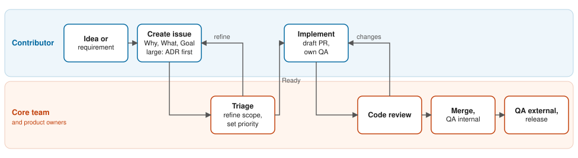
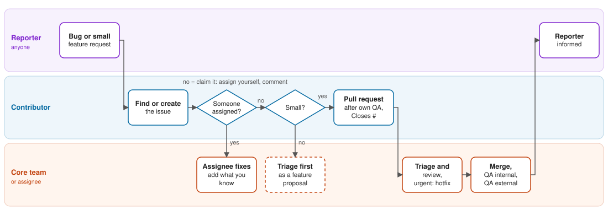

# Contributing to ORISO

This guide is for everyone who works on ORISO: the core team and external contributors such as
organisations, agencies and individuals, also when they work on behalf of a client. It applies
to every repository of the OpenResilienceInitiative organisation.

The short version:

- Every change starts with an issue, and every pull request links one. Small features and fixes
  can open the issue and the pull request together.
- Product owners decide priority and release; the core team reviews, merges and runs QA.
- Contributors run their own QA before a pull request goes to review.
- Whoever works on an issue is its assignee and says so in a comment, so nobody fixes the same
  thing twice.

## Roles

| Role | Who | Decides or does |
| --- | --- | --- |
| Product owners | Designated by the Open Resilience Initiative | Priority, release planning, QA external, closing issues |
| Core team | Maintainers of the repositories | Triage, code review, merging, QA internal |
| Contributors | Anyone else, also on behalf of a client | Issues, implementation, own QA, pull requests |

## Where things live

- **Issues** in the repository where the problem shows. A change that spans repositories gets one
  parent issue there, and every pull request in every repository links it.
- **Project board** "ORISO Roadmap": the single place for status, priority and release.
- **Architecture decisions** (ADRs) in [ORISO-Docs](https://github.com/OpenResilienceInitiative/ORISO-Docs/tree/dev/oriso-platform/decisions).
  See [Does my change need an ADR?](#does-my-change-need-an-adr)
- **Branches**: `dev` is the integration branch, `main` is the release. Pull requests target `dev`.

## Board statuses

| Status | Meaning |
| --- | --- |
| Backlog | Not yet fully defined |
| Ready | Defined from the client's perspective and ready to implement |
| On hold | Blocked by something else |
| In progress | Someone is working on it; that person is the assignee and a pull request is linked |
| In review | The pull request is in code review |
| QA internal | Merged to `dev`, deployed to the development environment, awaiting internal approval |
| QA external | Deployed to staging, awaiting approval by the product owners |
| Done | Approved by the product owners |

Work from Ready in this order: bugs before features and tasks, within each priority from Urgent
to Low. Backlog items are only started after talking to the product owners.

## Proposing a feature

Larger changes go through triage before anyone writes code. Contributors who work on behalf of a
client clarify the scope with the client before they create the issue.

### Triage and refinement

Triage is often a conversation, not a single decision. The product owners may ask for a smaller
scope, a different approach or a split into several issues. Contributors who work on behalf of a
client agree such changes with the client, and the issue is updated in place, so that its Why,
What and Goal always describe what will be built. While this is open, the issue carries
`needs refinement`. It moves to Ready once the product owners and the contributor agree on the
goal and the acceptance criteria.

## Proposing a small feature or fix

**Small features and fixes do not wait for triage: open the issue and the pull request together.**
Triage and review then run in parallel, and the core team can still ask for changes or decline.

Small means all of the following:

- a bug fix or a minor improvement of existing behaviour,
- no ADR needed (see [Does my change need an ADR?](#does-my-change-need-an-adr)),
- reviewable in one pull request.

Anything bigger follows [Proposing a feature](#proposing-a-feature). Anyone may fix a bug, also one
they did not cause; check the issue first so that two people do not fix the same thing.

## Does my change need an ADR?

An architecture decision record (ADR) captures a decision that is hard to reverse or that others
will build on. Decide this in the issue, before the code: an ADR found necessary in review means
reworking the pull request.

**Write an ADR, or amend an existing one, if your change does any of the following:**

| The change | Examples |
| --- | --- |
| Contradicts or changes what an existing ADR decided | amendments to ADR-014 and ADR-020 |
| Adds a service, an extension point, or a contract that other services, clients or third parties rely on (APIs between services, events, manifests, templates) | ADR-034 add-ons, ADR-026 e-mail branding |
| Changes roles, permissions, or who may see which data | ADR-008 supervision, ADR-035 statistics reader |
| Touches privacy, security, consent or legal texts | ADR-019 media scanning, ADR-022 consent gates |
| Introduces a persisted concept other parts depend on, or a data change that cannot be rolled back | ADR-006 conversation type, ADR-038 user IDs |
| Adopts or removes a framework, library or external system the platform commits to | ADR-004 Matrix SDK, ADR-032 FullCalendar instead of cal.com |
| Makes behaviour differ per Träger, or adds a platform-wide switch or default | ADR-010 appearance allowlist, ADR-014 one topic per agency |

**No ADR is needed for:**

- bug fixes that restore the intended behaviour,
- UI changes within existing patterns and the design system,
- refactoring, tests, documentation and dependency updates that add no new framework,
- new fields or endpoints inside one service that follow its existing contracts and permissions,
- implementing what an accepted ADR already decided.

**Not sure?** Ask in the issue ("Does this need an ADR?"). The product owners decide during triage.

**How to write one:**

1. Use the next free number in `oriso-platform/decisions/` in ORISO-Docs, or add an amendment to the
   existing ADR when you change it.
2. Start with the header: status *Proposed*, date, decision owner, related ADRs and the issue.
3. Write the sections *In plain words*, *Context*, *Decision* and *Consequences*; add *Considered
   options* when there were real alternatives. Recent ADRs such as ADR-035 are good templates.
4. Open the pull request in ORISO-Docs and link it from the issue. Implementation pull requests
   reference the ADR. The product owners accept it.

## Issues

Every issue states three things:

1. **Why**: the problem in one to three sentences.
2. **What**: the change asked for.
3. **Goal**: what is true when it is done, with acceptance criteria. Reviewers and QA test
   against the goal.

Then:

- Set the issue type (Epic, Feature, Bug, Task).
- Add it to the project board. Contributors may propose a priority and a release in the text;
  the product owners set the fields.
- Add labels where they apply (see below).
- Keep the status and the assignee current, and document findings and decisions as comments.
- Do not close issues yourself. The product owners close them after QA external; duplicates are
  the only exception.

### Labels

| Label | Use |
| --- | --- |
| `bug` | Something does not work as intended |
| `enhancement` | New or improved behaviour |
| `needs triage` | New, waiting for the core team to review, prioritise and route |
| `needs refinement` | Scope or technical requirements need more discussion |
| `help wanted` | Open for contributors outside the core team |
| `good first issue` | Suitable for newcomers |
| `duplicate` | Already exists elsewhere |
| `wontfix` | Will not be worked on |

## Branches and pull requests

- Branch from the current `dev`: `feat/<topic>`, `fix/<topic>`, `chore/<topic>`, `docs/<topic>`.
  External contributors with write access prefix their organisation, for example
  `acme/fix/<topic>`.
- Open a draft pull request as soon as work starts and link the issue with `Refs #<nr>`. The
  last pull request for an issue uses `Closes #<nr>`; the board automation relies on it.
- One concern per pull request. Link counterpart pull requests in other repositories, and post
  each one as a comment on the parent issue.
- Keep the description short: the problem in one or two sentences, the changes in three to six
  bullets, and the verification as commands.
- Run the repository's validation before asking for review (see its `AGENTS.md` or `README.md`)
  and add Storybook screenshots for visible UI changes.
- Do your own QA before the pull request leaves draft: run the change, check it against the
  issue's goal, and note in the issue how to verify it.
- Assign a reviewer and post the link in the code review channel.
- Address review comments with new commits. Do not force-push once review has started. Merge
  `dev` into your branch when it conflicts.

After the merge, delete your branch. The board automation moves the issue to QA internal when the
merged pull request closed it, it has an assignee and the pull request has a human approval.

## Working from outside the organisation

Pull requests from a fork work, with two limits:

- **CI needs approval.** Workflows on pull requests from forks only run after a maintainer
  approves them, on every push.
- **Maintainers cannot push to forks owned by an organisation.** GitHub offers "Allow edits by
  maintainers" only for forks owned by a personal account.

Contributors who work with the core team regularly can ask for write access to the repositories
they work in. They then push branches with their prefix to the ORISO repository itself; `dev` and
`main` stay protected by the branch rules (pull request, review, required checks, merge queue).

## License

ORISO is licensed under AGPL-3.0, see [LICENSE](https://github.com/OpenResilienceInitiative/.github/blob/main/LICENSE).
