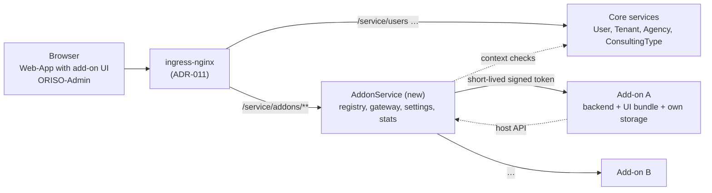

# ADR-034: Add-ons, optional services with their own UI, discovered by the platform and enabled per Träger

- **Status:** Proposed, 2026-11-12. Discussed at the DigiSucht kickoff (Caritas, delphi, BITS GmbH); needs product and technical sign-off.
- **Date:** 2026-11-06 (updated 2026-11-12, 2026-11-13 and 2026-11-16 with the results of a working implementation)
- **Deciders:** ORISO product owner and platform leads; BITS GmbH (DigiSucht) as proposer
- **Related:** ADR-001 (modules toggleable per tenant and per agency), ADR-010 (per-Träger allowlist computed server-side), ADR-011 (single domain, path-based routing under `/service/*`), ADR-024 (notification matrix), ADR-030 (Activity Timeline), ADR-032 (counsellor calendar); `ORISO-Frontend/src/extensions` (build-time file replacement, unchanged by this ADR)
- **Reference implementation:** [BITS-GmbH/ORISO-AddonService](https://github.com/BITS-GmbH/ORISO-AddonService), offered for transfer into this organisation once the ADR is accepted; first add-on [BITS-GmbH/oriso-addon-digisucht-tools](https://github.com/BITS-GmbH/oriso-addon-digisucht-tools); host changes in ORISO-Frontend, ORISO-Admin, ORISO-UserService and ORISO-Helm (PRs linked from this ADR's PR)

---

## Context

The DigiSucht instance needs several larger functions that ORISO does not have and that only some Träger will want: nine digital counselling tools (interactive exercises such as Motivationswaage or Konsumtagebuch), a survey tool (questionnaires in counselling and time-limited evaluations for whole user groups) and a counselling documentation system. delphi's tender requires that these are built **modular, usable optionally by other instances, with the core functionality of ORISO unchanged**, and that they are integrated into the shared code base of the Open Resilience Initiative.

ORISO has no runtime extension point today:

- `ORISO-Frontend/src/extensions` replaces source files **at build time**. It works for theming (DigiSucht uses it for fonts, texts and its registration page), but every override is a fork of one file: it cannot import the file it replaces and silently diverges when upstream changes.
- Features are switched on per Träger through tenant settings (`feature…Enabled` flags), which only works for code that already lives in the core.
- The backend is a fixed set of Spring services behind ingress-nginx with one Ingress per service (`/service/users`, `/service/agencies`, …, ADR-011). nginx cannot route to services it learns about at runtime.

Building each of these functions into the core would grow ORISO by three large, DigiSucht-driven modules that every other Träger then carries, reviews and upgrades. Keeping them in forks would contradict the tender and fragment the platform.

## Decision drivers

- New functions must not change ORISO's core behaviour, and must be switchable per Träger and per agency (ADR-001).
- Other operators must be able to install a published add-on into their instance if they want it.
- Add-ons must feel like part of ORISO: same login, same design, same language and form of address, shown in the places where users already work.
- Admins manage add-ons in the existing ORISO-Admin, not in a separate admin application per add-on.
- Deletion, data export and notifications must keep working across core and add-ons (GDPR, tender requirements).
- Operations stay Kubernetes and Helm based (ADR-011), observable like every other ORISO service.

## Decision

Introduce **add-ons**: separately deployed services that bring a backend and a frontend bundle, are discovered by the platform, and are enabled per Träger. One new core service, the **AddonService**, connects them to ORISO.



### 1. What an add-on is

- A service in its own Kubernetes namespace (default `addons`), installed with its own Helm chart, written in any language; the contract prescribes no technology. For add-ons maintained by the ORISO community, Spring Boot is recommended because it matches the core services. The first add-on is a small Node service, to show that the contract does not depend on the stack.
- It owns its storage. It has no direct access to MariaDB, MongoDB, Redis or Matrix.
- It carries the label `oriso.io/addon: "true"` on its Service and serves a **manifest** at `GET /.well-known/oriso-addon.json`.
- It may contain one or more apps.

Manifest (contract `oriso-addon/v1`; `react` names the React major the bundle expects from the host (section 4), `calendar` is the add-on's calendar route (section 6), `visibility` is explained in section 2; entries for export and lifecycle events are reserved for section 6 and `health` for section 7, none of them evaluated yet):

```json
{
  "name": "digisucht-tools",
  "version": "1.4.0",
  "contract": "oriso-addon/v1",
  "react": "^19",
  "apps": [{ "id": "goals", "title": { "de": "Ausgangssituation und Ziele" }, "slots": ["asker.navigation", "consultant.session", "consultant.asker-profile"], "visibility": "dynamic" }],
  "ui": "/ui/entry.js",
  "settings": "/schema/settings.json",
  "calendar": "/calendar",
  "stats": [{ "id": "released", "label": { "de": "Freigegebene Tools" }, "type": "count" }],
  "health": "/health"
}
```

### 2. Discovery and enablement

- The AddonService lists Services with the label in the add-on namespace every 30 seconds (read-only RBAC on Services in that namespace) and reads each manifest. A static list in the Helm values is the fallback for environments without the Kubernetes API.
- A discovered add-on is **available**, not active. Enablement lives in the AddonService:
  - A **SuperAdmin** switches an add-on on or off per Träger.
  - Träger admins can override that per **agency**. An agency override only takes effect while the add-on is enabled for the Träger, so a Träger switch is always a complete off switch.
  - Like ADR-010, the effective state is computed server-side; a client only learns the add-ons enabled for itself.
- **What a user sees is decided in three stages, all in the AddonService; the UI only shows what the registry returns:**
  1. *Enablement (operator, static):* the Träger switch and agency overrides. The registry evaluates them **in context**: the web app asks with the same `X-Oriso-Agency-Id` / `X-Oriso-Session-Id` headers as its API calls, so a counsellor in a case sees only add-ons enabled for that case's agency, and a disabled add-on shows no button, tile or menu entry at all. Without a context header the registry uses the caller's own agencies (a counsellor's agencies, a client's session agencies): an add-on is listed if it is enabled for at least one of them.
  2. *Slot and role (manifest, static):* the slot decides the audience (section 4).
  3. *App state (add-on, dynamic):* an app marked `"visibility": "dynamic"` in the manifest is only listed if the add-on says so for this person. The AddonService asks `GET /visibility` with a user-scoped add-on token (including agency and session context) and gets per app `visible` and an optional `badge` count (for example "1 new"). Answers are cached for a short time per user and context. If the add-on does not answer in time, a dynamic app stays hidden. Example: the client's menu entry for a tool only appears once a counsellor has released it.
- **Trust model:** installed add-ons are trusted. The operator decides what is installed; there is no per-add-on permission model in v1.

### 3. Backend: one route, one gateway

- One new Ingress route `/service/addons/**` points to the AddonService. No per-add-on Ingress, no change to existing routes (ADR-011).
- For every request to `/service/addons/<name>/api/**` the AddonService validates the Keycloak token, checks that the add-on is enabled for the caller's Träger and agency, and forwards the request with a **short-lived token** for that add-on only:
  - RS256, issuer `oriso-addonservice`, audience = the add-on's name, valid for a few minutes.
  - Claims: subject, username, roles, tenant, and where applicable agency, session and client (`agencyId`, `sessionId`, `askerId`).
  - The public keys are served at `/service/addons/.well-known/jwks.json`, so add-ons verify tokens without a shared secret and without integrating Keycloak. The user's own token never leaves the core.
- **Context is checked, not trusted.** The UI asks for context with the headers `X-Oriso-Agency-Id` and `X-Oriso-Session-Id`. The AddonService verifies the agency against the caller's memberships and the session against UserService (only a counsellor with access to that session gets it) and only then puts it into the token, together with the session's client.
- **Core gates are known to add-ons.** Platform-wide gates such as the DPA gate ("new counselling blocked until the Träger has confirmed the current DPA") are served to add-ons through the host API (`GET /addons/host/gates`, section 6), and each add-on decides what a closed gate means for it: the tools add-on, for example, refuses new releases but keeps released tools and answers usable. The gateway does not know add-on semantics, so it does not block on its own. Operators enable an add-on for a Träger only when its DPA is in order; a hard block in the gateway remains possible later if ORISO wants it. Account inactivity needs no add-on handling: a locked account gets no token and so never reaches the gateway.
- Add-ons call back into ORISO only through the **host API** of the AddonService (section 6), authenticated with their own add-on token.

### 4. Frontend: slots and a mount contract

There is one kind of add-on. It declares in its manifest which **slots** its apps appear in; the slot decides who sees the app, where, and which context it receives. An add-on can use several slots, for example the tools add-on gives clients their own page and counsellors a panel in the case view.

| Slot | Audience | Place | Context in addition to user, role and Träger |
|---|---|---|---|
| `asker.navigation` | Clients | own page in the navigation of the web app | none |
| `consultant.navigation` | Counsellors | own page in the navigation of the web app | agency |
| `consultant.session` | Counsellors | side panel in the case view | agency, open session, its client |
| `consultant.asker-profile` | Counsellors | tile in the client profile overview | agency, client |
| `admin.page` | Admins | own page in ORISO-Admin | admin level, Träger, agency where applicable |

- When a user opens an add-on app, the web app or ORISO-Admin loads the add-on's bundle from `/service/addons/<name>/ui/…` (same origin, no change to security headers) and mounts it into the slot.
- **Bundles are public code.** A browser's module import cannot send a bearer token, so `/ui/**` is served without authentication. Bundles must contain code only, never data; everything user-related goes through the authenticated API.
- An add-on can further restrict an app by role inside its slot; it cannot widen the audience of a slot.
- **Lifecycle:** the bundle exports `bootstrap`, `mount(element, context)`, `unmount` and optionally `update(context)`, the shape of a single-spa parcel, so authors can use existing adapters. `update` lets the host pass a new context (for example another session) without remounting. `context` carries the user and role, tenant, locale including the form of address (`de` / `de@informal`), the tenant's theme tokens, the slot context from the table above, an API client bound to the add-on's own route, `navigate` and `notify`.
- **Shared React:** the host provides its React, ReactDOM client and JSX runtime on `globalThis.__ORISO_ADDON_SHARED__`. An add-on uses these instead of bundling React, which keeps one React instance per page and lets a bundle be a plain ES module without a build step. Other libraries, including MUI, are bundled by the add-on.
- Add-ons ship their own translations; the host only passes the active locale.

### 5. Admin: settings, statistics and admin pages in ORISO-Admin

- **Settings** need no UI from the add-on: the manifest points to a **JSON Schema**, ORISO-Admin renders the form, and the AddonService stores the values and serves them to the add-on through the host API. v1 supports a deliberately small subset: an object of `string`, `boolean`, `number` and `integer` properties with `title`, `description` and `default`, plus `enum` and `maxLength` for strings and `minimum`/`maximum` for numbers. Values merge in the order **schema defaults, Träger, agency**.
- **Statistics:** the manifest declares them (id, label, type). The AddonService fetches aggregated, anonymous values per Träger from the add-on's `/stats?tenantId=…` with a service token (role `addon-service`); add-ons never push. ORISO-Admin shows them as tiles.
- **Admin pages** (`admin.page`) are for add-ons whose administration is more than configuration, for example the survey editor. ORISO-Admin lists them in its navigation and mounts them with the same contract as the web app.

### 6. Host API and lifecycle events

- **Settings:** `GET /addons/host/settings` returns the effective settings for the token's Träger and agency.
- **Core gates:** `GET /addons/host/gates` returns the gates of the token's Träger, today the DPA gate (status, signed, `newCounsellingAllowed`, grace period, deadline), read from the TenantService and cached briefly.
- **Context:** `GET /addons/host/context` resolves the sessions (agency, counsellor, status), agencies and counsellors of the token's user or, for a counsellor in a verified session, of that session's client; always within the token's Träger and, with an agency in the token, that agency. The AddonService reads it from UserService (`GET /users/addon-context`, technical role) and caches it briefly.
- **Notifications:** an add-on asks the core to notify a person (for example "a new tool has been released for you") with a title, a short text, a link back into the add-on and one flag: important or not. It never chooses a channel. The core delivers through its existing channels (Activity Timeline, e-mail, push; ADR-024, ADR-030) according to the person's own notification preferences, and only addresses people within the caller's context: the caller's Träger, clients only through a session the caller may access, and the counsellors of a client (`recipient: "counsellors"`) only for the client themself or a counsellor in that client's session. Add-ons have no mail configuration of their own; if mail is off in the core it is off for add-ons too.
- **Audit entries (write only):** an add-on reports auditable actions (for example "counsellor released tool X to client Y"). The AddonService stamps each entry with actor, time, Träger and add-on, stores it, and ORISO-Admin shows it in its existing Logs area next to the core's audit logs, with the same visibility rules per admin level. Add-ons can only write entries; they cannot read the log, not even their own entries.
- **Calendar entries (read only):** an add-on can declare that it has dated entries such as appointments, deadlines or reminders. The core asks it for the entries of one person in a time range, the way it fetches statistics, and shows them in the counsellor calendar (ADR-032) together with its own appointments. Each entry has a title, a start (and optional end), a kind and a link into the add-on. The calendar only shows and links; booking, moving or cancelling happens inside the add-on.
- **Data export:** add-ons expose an export endpoint; the central export collects it, configurable per admin level as the tender requires. This depends on the central export.
- **Lifecycle events** via RabbitMQ (already part of the platform): UserService publishes `user.deleted` and `session.deleted`, TenantService `tenant.deleted`, on the topic exchange `oriso.lifecycle` after the deletion is committed (ids only, no personal data). The AddonService consumes them with a durable queue of its own and forwards each event to every add-on that lists its type in the manifest's `events`, as `POST /events` with a service token; deliveries are stored and retried with growing pauses, so an add-on that is down receives them later. Add-ons therefore need no access to RabbitMQ. Handlers must be **idempotent and tolerate unknown ids**: a Träger created and rolled back within a second still produces a deletion event, and events can arrive twice.

### 7. Operations

- Network policies allow traffic into the add-on namespace only from the AddonService; outbound only to the AddonService host API and the add-on's own storage.
- Every add-on exposes its health route and OpenTelemetry, and appears in the Health Dashboard and SigNoz like a core service.
- The AddonService can switch an add-on off per Träger or globally at any time.
- The AddonService is part of the ORISO Helm chart, disabled by default.

### 8. Versioning

- The contract is versioned (`oriso-addon/v1`), independently of ORISO releases. Breaking changes require a new contract version; the AddonService can serve more than one version during a transition.
- Each ORISO release states which contract versions its web app, ORISO-Admin and AddonService support. Operators who stay on an older release line need the host side backported to it; the reference implementation was backported to 2.0.15 for the DigiSucht test instance.

## Consequences

**Positive**

- Large, Träger-specific functions stay out of the core and its review queue; the core grows by one service and a small set of frontend slots.
- Add-ons release independently; ORISO upgrades do not wait for partners.
- Other operators can install published add-ons and enable them for their own Träger.
- One place for auth, enablement, core gates, logging and the kill switch.

**Negative / cost**

- A new core service to build and run, and a public contract that ORISO has to keep stable.
- Shared React couples add-ons to the host's React major; a React major upgrade in ORISO needs an announcement and compatible add-on releases.
- Trusted, in-page add-ons can see what the page can see. This is acceptable only because operators choose what they install; it must be stated in the operator documentation.
- ORISO-Admin needs a JSON Schema form, statistics tiles and the same slot loader as the web app.

## Considered options

- **Build the functions into the core.** Rejected: contradicts the tender's "core unchanged" requirement and makes every Träger carry DigiSucht-specific modules.
- **Only build-time file replacement (`src/extensions`).** Rejected: no backend story, every override is a fork of an upstream file, nothing can be shared with other instances. It stays as the theming mechanism.
- **One Ingress per add-on, no gateway.** Rejected: every add-on would have to validate Keycloak tokens, enablement and core gates itself, there is no central kill switch, and every install touches the ingress setup.
- **Iframe-only integration.** Rejected for v1: strongest isolation, but no shared theme or React, awkward layout in slots. Can be added later as a second integration mode for untrusted add-ons.
- **A permission or scope model per add-on.** Deferred: with operator-installed, trusted add-ons it adds approval work without a real gain in v1.
- **Enablement as tenant settings in TenantService.** Rejected: agency overrides and per-add-on state would add a second, differently shaped settings store to TenantService; the AddonService already owns the registry and the gateway check.
