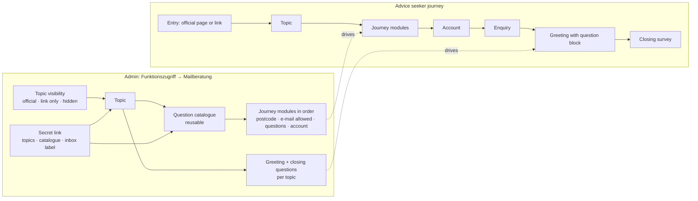

# ADR-036 delivery plan: conversation modules, questions, registration journeys

Working plan for [ADR-036](./ADR-036-configurable-conversation-modules-and-one-question-model.md).
It is the hand-over surface: anyone (a person, Claude Code, Codex) can continue
from here on another machine. Status is as of **2026-11-17**.

## Resume here

1. Read this file, then ADR-036.
2. Read **Frank's review of 2026-11-17** below. It changes the direction of the
   registration part, and the next step is a redesign, not more building.
3. Check out the four draft branches (table below). Nothing is merged, nothing
   is deployed.
4. Run the two Storybooks (commands below) to see the current state.

## Where everything is

| Repo | Branch | Draft PR | What it holds |
|---|---|---|---|
| ORISO-Docs | `docs/adr-035-configurable-first-reply` | OpenResilienceInitiative/ORISO-Docs#273 | ADR-036 (accepted 2026-11-17) and this plan |
| ORISO-Admin | `feat/platform-greeting-tab` | OpenResilienceInitiative/ORISO-Admin#1551 | Platform and centre greeting tabs (first slice) + conversation module configurator prototype + screenshots |
| ORISO-UserService | `feat/platform-greeting-override` | OpenResilienceInitiative/ORISO-UserService#1680 | Platform and centre text override storage and API (first slice) |
| ORISO-Frontend | `feat/erstantwort-v2-sections` | OpenResilienceInitiative/ORISO-Frontend#2315 | Version-2 first-response rendering with a question block + screenshots |

All four PRs are drafts and belong together. They are one PR set and land
with the builder (ADR-036 "Consequences"). Hub issues:
OpenResilienceInitiative/ORISO-Frontend#824 (Erstantwort epic) and
OpenResilienceInitiative/ORISO-Admin#601 (agency editor).

**For developers — run it locally (skip if you only need the status):**

```text
# Admin Storybook (configurator)
cd ORISO-Admin && git switch feat/platform-greeting-tab && npm ci && npm run storybook -- -p 6233
open http://localhost:6233/?path=/story/settings-conversation-modules--greeting-dialog

# Frontend Storybook (what the advice seeker sees)
cd ORISO-Frontend && git switch feat/erstantwort-v2-sections && npm ci --legacy-peer-deps && npm run storybook -- -p 6234
open http://localhost:6234/?path=/story/components-chat-erstantwort-module--with-question-block

Node 22 for both. Story ids: settings-conversation-modules--* (Admin, 8 stories),
components-chat-erstantwort-module--* (Frontend, 9 stories).
Screenshots: ORISO-Admin docs/storybook/issue-601-conversation-modules/,
ORISO-Frontend docs/storybook/issue-824-erstantwort-v2/ (desktop + 390 px mobile).
```

## What is built (Storybook only)

| Piece | State |
|---|---|
| Admin: one tile per conversation type with "Begrüßung" and "Abschließende Fragen" | ✅ prototype, local state only |
| Admin: configurator dialog (message, panel, fixed module, question block; reorder, remove, safety warning, reset to prototype) | ✅ prototype |
| Admin: question editor (free text, single select as radio or dropdown, multi select, hint; required per question; version bump on publish) | ✅ prototype |
| Admin: "Registrierung pro Thema" tab (postcode on/off and "link only" per topic) | ✅ prototype, **superseded by the review below** |
| Frontend: version-2 payload parser and renderer, question block, "after first reply" trigger | ✅ Storybook, not wired into the chat |
| UserService: platform and centre text overrides (first slice, fixed slots) | ✅ code + tests, to be replaced by module storage |
| Storage of modules and answers, menu wiring, chat wiring, secret links | 💤 not started |

## Frank's review, 2026-11-17

Overall the work is well thought through. The shortcomings:

1. **Links are missing.** In Mailberatung a link cannot be created yet, so
   questions cannot be attached to a link.
2. **Too coarse.** Today there is one greeting and one set of closing questions
   per conversation type. They cannot be set **per topic**.
3. **Topic visibility is missing where it belongs.** Which topics appear in
   registration (for example: U25 suicide prevention does not) should be set in
   *Funktionszugriff → Mailberatung*, as a visibility setting.
4. **Postcode is a hard-coded switch.** "Ask for postcode" (and similar
   defaults such as "allow e-mail") should be **modules** in the journey, not
   fixed toggles. Thinking modularly lets each topic's user journey be
   individualised.
5. **Think and show it as a user journey.** The registration logic is a journey
   from the advice seeker's view; the editor should see and shape that journey,
   ideally visualised. In the prototype the registration tab sits oddly at the
   end of the greeting dialog.

### Target shape (Frank's words, turned into a flow)

1. Open **Mailberatung**.
2. Choose **which topics show in registration** (and which are reachable only
   by link).
3. Open a topic and choose **which question catalogue** it loads.
4. Inside the journey, the standard steps (postcode, e-mail allowed, …) are
   **modules** like any other, placed in order.
5. Greeting and closing questions can be set **per topic** too.
6. **Links:** create a link, choose its topic(s), attach a question catalogue,
   set the inbox label.



### Open questions for the redesign

1. Is a **question catalogue** a reusable library item (one catalogue, many
   topics and links), or does each topic own its questions?
2. Do greeting and closing questions resolve **per topic first, then per
   conversation type** (`topic ?? conversation type ?? platform ?? prototype`),
   or does a topic replace the conversation-type level completely?
3. Who may change topic visibility and journeys: platform only, or also Träger
   and Beratungsstelle (ADR-036 decision 14 allows all three to create links)?
4. Should the journey editor be a **visual journey** (steps left to right, as
   in the diagram) rather than a list in a dialog?

ADR-036 part C (decisions 15–17) needs an amendment once these are answered.

## Checkpoints

Each checkpoint is one reviewable step. Order matters top to bottom.

- [x] ADR-036 written and accepted (2026-11-17)
- [x] Admin configurator prototype in Storybook (desktop + mobile)
- [x] Frontend version-2 rendering with question block in Storybook
- [ ] **Redesign the registration part as a user journey** (Frank's review): topic visibility in Funktionszugriff → Mailberatung, question catalogues, journey modules (postcode, e-mail), greeting/closing per topic, secret links. Storybook first, then an ADR-036 amendment.
- [ ] Group settings dialog (Frontend `CircleSettingsView`) using the shared configurator
- [ ] UserService: store modules per level (replaces the fixed-slot overrides), answers table keyed by conversation, question id and version
- [ ] Admin: wire the configurator into the menu, replace the fixed-slot greeting tabs
- [ ] Frontend: wire version-2 events into the chat (`ErstantwortMessage`), send answers
- [ ] Secret links for Mailberatung (create, topics, catalogue, inbox label)
- [ ] Migration of old texts and fields (ADR-036 decision 22)
- [ ] One PR set ready for review, reviewers requested, then Dev deploy and test on dev.oriso.org

## Side findings (not part of this work)

- Native `<select>`/checkbox controls in Frontend product screens: separate
  session "replace raw form controls + lint guard".
- A centre-only admin cannot use AI translation in the greeting editor.
- OpenResilienceInitiative/ORISO-Frontend#825: client-side trigger still uses the fixed catalogue.
- Some live installs require age/state at registration; confirm before the
  migration (ADR-036 open question 3).
