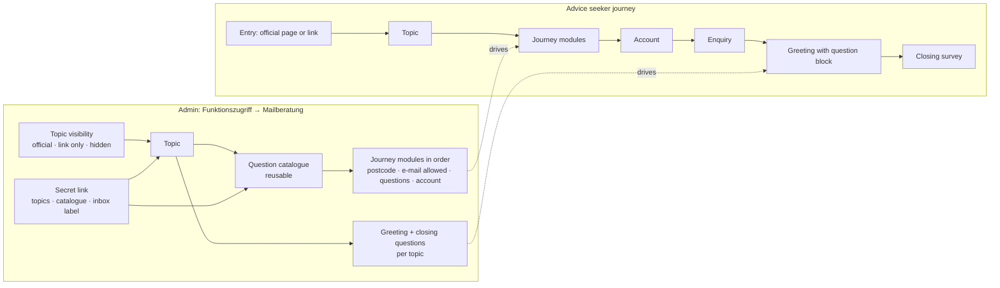

# ADR-036 delivery plan: conversation modules, questions, registration journeys

Working plan for [ADR-036](./ADR-036-configurable-conversation-modules-and-one-question-model.md).
It is the hand-over surface: anyone (a person, Claude Code, Codex) can continue
from here on another machine. Status is as of **2026-11-18**.

## Resume here

1. Read this file, then ADR-036.
2. Read **Frank's review of 2026-11-17** and **the journeys round of
   2026-11-18** below. The registration part is now designed as journeys
   (ADR-036 part E, proposed); Frank decides on part E before backend work.
3. Check out the four draft branches (table below). Nothing is merged, nothing
   is deployed.
4. Run the two Storybooks (commands below) to see the current state.

## Where everything is

| Repo | Branch | Draft PR | What it holds |
|---|---|---|---|
| ORISO-Docs | `docs/adr-035-configurable-first-reply` | OpenResilienceInitiative/ORISO-Docs#273 | ADR-036 (accepted 2026-11-17) and this plan |
| ORISO-Admin | `feat/platform-greeting-tab` | OpenResilienceInitiative/ORISO-Admin#1551 | Platform and centre greeting tabs (first slice) + conversation module configurator prototype + screenshots |
| ORISO-UserService | `feat/platform-greeting-override` | OpenResilienceInitiative/ORISO-UserService#1680 | Platform and centre text override storage and API (first slice) |
| ORISO-Frontend | `feat/erstantwort-v2-sections` | OpenResilienceInitiative/ORISO-Frontend#2315 | Version-2 first-response rendering with a question block + screenshots |

All four PRs are drafts and belong together. They are one PR set and land
with the builder (ADR-036 "Consequences"). Hub issues:
OpenResilienceInitiative/ORISO-Frontend#824 (Erstantwort epic) and
OpenResilienceInitiative/ORISO-Admin#601 (agency editor).

**For developers — run it locally (skip if you only need the status):**

```text
# Admin Storybook (journeys + configurator)
cd ORISO-Admin && git switch feat/platform-greeting-tab && npm ci && npm run storybook -- -p 6233
open http://localhost:6233/?path=/story/settings-journeys--journeys-of-mailberatung
open http://localhost:6233/?path=/story/settings-funktionszugriff-journeys--on-every-tile

# Frontend Storybook (what the advice seeker sees)
cd ORISO-Frontend && git switch feat/erstantwort-v2-sections && npm ci --legacy-peer-deps && npm run storybook -- -p 6234
open http://localhost:6234/?path=/story/components-chat-erstantwort-module--with-question-block

Node 22 for both. Story ids: settings-journeys--* (Admin, 22 stories), settings-funktionszugriff-journeys--*
(Admin, 2), settings-conversation-modules--* (Admin, 8),
components-chat-erstantwort-module--* (Frontend, 9 stories).
Screenshots: ORISO-Admin docs/storybook/issue-601-conversation-modules/,
ORISO-Frontend docs/storybook/issue-824-erstantwort-v2/ (desktop + 390 px mobile).
```

## What is built (Storybook only)

| Piece | State |
|---|---|
| Admin: one tile per conversation type with "Begrüßung" and "Abschließende Fragen" | ✅ prototype, local state only |
| Admin: configurator dialog (message, panel, fixed module, question block; reorder, remove, safety warning, reset to prototype) | ✅ prototype |
| Admin: question editor (free text, single select as radio or dropdown, multi select, hint; required per question; version bump on publish) | ✅ prototype |
| Admin: "Registrierung pro Thema" tab (postcode on/off and "link only" per topic) | ✅ prototype, **superseded by journeys** |
| Admin: **Journeys** — tile per conversation type, journeys dialog, phases with steps (drag, keyboard, must steps, add core/add-on/question/rating/info panel/message), step dialog with translation state and AI, destinations with routes and links per topic | ✅ prototype, local state only (2026-11-18) |
| Admin: **name and icon per conversation type** (7 languages, SVG outline 200/400/filled, platform only) | ✅ prototype, local state only (2026-11-18) |
| Admin: journeys entry on the Funktionszugriff tiles (`renderJourneys` slot) | ✅ story only, not wired into the page |
| Frontend: version-2 payload parser and renderer, question block, "after first reply" trigger | ✅ Storybook, not wired into the chat |
| UserService: platform and centre text overrides (first slice, fixed slots) | ✅ code + tests, to be replaced by module storage |
| Storage of modules and answers, menu wiring, chat wiring, secret links | 💤 not started |

## Frank's review, 2026-11-17

Overall the work is well thought through. The shortcomings:

1. **Links are missing.** In Mailberatung a link cannot be created yet, so
   questions cannot be attached to a link.
2. **Too coarse.** Today there is one greeting and one set of closing questions
   per conversation type. They cannot be set **per topic**.
3. **Topic visibility is missing where it belongs.** Which topics appear in
   registration (for example: U25 suicide prevention does not) should be set in
   *Funktionszugriff → Mailberatung*, as a visibility setting.
4. **Postcode is a hard-coded switch.** "Ask for postcode" (and similar
   defaults such as "allow e-mail") should be **modules** in the journey, not
   fixed toggles. Thinking modularly lets each topic's user journey be
   individualised.
5. **Think and show it as a user journey.** The registration logic is a journey
   from the advice seeker's view; the editor should see and shape that journey,
   ideally visualised. In the prototype the registration tab sits oddly at the
   end of the greeting dialog.

### Target shape (Frank's words, turned into a flow)

1. Open **Mailberatung**.
2. Choose **which topics show in registration** (and which are reachable only
   by link).
3. Open a topic and choose **which question catalogue** it loads.
4. Inside the journey, the standard steps (postcode, e-mail allowed, …) are
   **modules** like any other, placed in order.
5. Greeting and closing questions can be set **per topic** too.
6. **Links:** create a link, choose its topic(s), attach a question catalogue,
   set the inbox label.



### Journeys round, 2026-11-18

Frank's sketch (`paths`) turned the registration redesign into **journeys**:
three phases named after a flight (departure, flight, arrival), steps in
each phase, routes (registration or own link) that lead onto a journey, and
topics as its destinations. Recorded as ADR-036 part E (proposed). Built in
the Admin Storybook the same day.

Frank's feedback on the first build, and what changed:

1. **Too many white boxes.** Everything is now an outline on the surface it
   sits on; only a selected state is filled.
2. **The Mailberatung tile said too little.** The tile now draws the flight
   (departure → flight → arrival → destinations), shows the number of
   journeys and destinations, the topics reached (registration or link), and
   one sentence on what a journey is and what editing it means.
3. **Journey cards.** Each phase tile lists its steps (must steps with a
   lock); the destinations tile lists the route path and the topics.
4. **Destinations were hard to use.** Routes now sit on top as buttons
   (`/registrierung`, every link, "Link erstellen"); below, one row per topic
   with a `/registrierung` toggle and "create a link for this topic", which
   names the link after the topic and jumps to it.
5. **New task: rename conversation types and upload their icons** (see
   checkpoints). Built as a platform-only dialog on every tile.

### Decisions of 2026-11-18, second round

Recorded as ADR-036 part E decisions 23 (wording), 29–35 and the ADR-018
amendment; built in the Admin Storybook the same day (stories 13–36).

| # | Decision | In the prototype |
|---|---|---|
| 1 | „Reise“; Check-in · An Bord · Ankunft with subtitles; hotel set as alternative; plane icons stay; final wording Frank's | all German texts |
| 2 | Centre fixed only by „Beratungsstelle wählen“ (or own link/subdomain); without postcode: list of the topic's centres | core step, not removable; notice in the check-in |
| 3 | Lower levels get the platform's journey via registration; change on board and arrival only | `level` prop; check-in tile locked below platform |
| 4 | Greeting and survey of the centre as core steps (variant 3) | shipped journeys use them |
| 5 | Funktionszugriff allows building blocks; Träger allows a centre to shape on board/arrival | `blocked` prop; skipped steps marked; new Träger permission only in ADR |
| 6 | „Alternative Beratung vorschlagen“ + manual trigger | core step, fixed manual trigger; arrival: on close or manual |
| 7 | One step = one chat message (ADR-018 amended); check-in step = screen | step label „Schritt n · Nachricht/Bildschirm“ |
| 8 | „Etwas anderes …“; scale −5 … +5 with 0 = „normal“; no number fields except real numbers; info panel separate from hint | question editor, scale presets |
| 9 | Funktionszugriff as the only place | **pending Frank** |

### Use case walk-through: a Träger extends on board and arrival

The point of this walk-through is the order in which things become known. It
is the source of most bugs to expect.

1. **Platform** keeps *Reise #1 Standard* for Mailberatung: check-in topic →
   postcode → Beratungsstelle wählen → user name → consent → e-mail; on board
   enquiry → greeting of the centre → suggest another service; arrival
   survey of the centre. All topics but U25 route `/registrierung` here.
2. **Träger „Caritas Köln“** opens Funktionszugriff → Mailberatung → Reisen.
   It sees Reise #1 with the check-in locked („Kommt von der Plattform“). On
   board it adds an info panel „Unsere Angebote vor Ort“ after the greeting
   and a question „Wie haben Sie von uns erfahren?“ after the first reply. At
   arrival it adds a rating „Wie geht es Ihnen jetzt?“ (−5 … +5). This is
   stored as Caritas Köln's version of Reise #1 (scope `TENANT`).
3. **Caritas Köln allows its centre A** to shape on board and arrival
   (decision 32). Centre A adds its own survey; centre B does not.
4. **An advice seeker** registers via `/registrierung`, topic Sucht, postcode
   50667. The postcode returns three centres, two of them Caritas Köln. Until
   „Beratungsstelle wählen“ nothing Träger-specific may show — the check-in is
   the platform's. The person picks centre A.
5. **On board** resolves `centre A ?? Caritas Köln ?? platform` per step block:
   enquiry, greeting of centre A (its module, decision 31), Caritas Köln's
   info panel, suggest another service. Each is one chat message, frozen when
   sent (decision 34). The question comes after the counsellor's first reply.
6. **Arrival** at close: centre A's survey. A person at centre B gets Caritas
   Köln's rating plus the platform survey of the centre.

Edge cases to test (each a likely bug):

- The topic moves from Reise #1 to Reise #2 on the platform: what happens to
  Caritas Köln's changes on Reise #1? Proposal: lower-level changes hang on the
  platform journey; if a topic leaves it, the Träger is told and its topic
  falls back to the new platform journey until it adds its changes there.
- Case handover to a centre of another Träger mid-conversation: messages
  already sent stay frozen; steps still to come (after-first-reply question,
  arrival) resolve by the **current** centre at send time.
- Centre A loses the permission to shape: its steps stop being sent, the
  stored version is kept (like a skipped step, decision 32).
- Funktionszugriff switches the e-mail block off for Caritas Köln while the
  platform check-in has the e-mail step: the step is skipped for its centres —
  but the check-in runs before the centre is known, so this permission can only
  act after „Beratungsstelle wählen“. Check-in steps after it must read it.
- A link with a preselected centre skips „Beratungsstelle wählen“; the Träger
  is known from the first screen.

### Ideas for reuse („pooling“) — for Frank

Goal: lower levels should not build the same survey ten times, and should not
spend hours in the editor.

1. **Building-block library („Bausteine“).** Every question step, rating,
   info panel or survey can be saved as a block with an owner (platform,
   Träger, centre) and a reach: *only me*, *my centres* (Träger), *everyone*.
   „Schritt hinzufügen“ gets a fourth column „Aus der Bibliothek“.
2. **Linked, not copied, by default.** A block taken from the library stays
   linked: when the owner improves it, every journey gets the improvement. „Lösen“
   makes a copy for local changes. Question versions (decision 9) keep old
   answers meaningful when a linked block changes.
3. **Insert points instead of copies.** A Träger does not copy Reise #1; it
   adds steps at marked points (after the greeting, before the survey). The
   editor shows each step with a level badge (P · T · B). Platform changes keep
   flowing in; nobody maintains a fork.
4. **Packages per topic.** A package bundles blocks for a topic („Schulden:
   Situation, Dringlichkeit, Rückblick“). When a topic is routed to a journey,
   its package is offered.
5. **„Wo verwendet“ and promotion.** Every block shows where it is used. The
   platform sees blocks Träger share widely and can promote one to the platform
   catalogue.
6. **Standard surveys for comparable statistics.** A few platform blocks with
   fixed question ids (satisfaction, how are you now −5 … +5). Same id across
   Träger means answers can be aggregated without mapping.

### Open questions for the redesign

1. Is a **question catalogue** a reusable library item (one catalogue, many
   topics and links), or does each topic own its questions?
2. Do greeting and closing questions resolve **per topic first, then per
   conversation type** (`topic ?? conversation type ?? platform ?? prototype`),
   or does a topic replace the conversation-type level completely?
3. Who may change topic visibility and journeys: platform only, or also Träger
   and Beratungsstelle (ADR-036 decision 14 allows all three to create links)?
4. Should the journey editor be a **visual journey** (steps left to right, as
   in the diagram) rather than a list in a dialog?

ADR-036 part C (decisions 15–17) needs an amendment once these are answered.

## Checkpoints

Each checkpoint is one reviewable step. Order matters top to bottom.

- [x] ADR-036 written and accepted (2026-11-17)
- [x] Admin configurator prototype in Storybook (desktop + mobile)
- [x] Frontend version-2 rendering with question block in Storybook
- [x] **Redesign the registration part as a user journey** (Frank's review): journeys with departure, flight, arrival; steps as core/add-on/question/rating/info panel/message; routes and links per topic. Storybook built 2026-11-18, ADR-036 part E proposed.
- [x] **Name and icon per conversation type** (Frank, 2026-11-18): rename in 7 languages, SVG icon in outline 200, outline 400 and filled, platform admin only, stored in the global configuration. Storybook built 2026-11-18.
- [x] Part E open question 1 decided (Frank, 2026-11-18): journeys for Träger and Beratungsstelle are the goal; first tested at platform level only (decision 29)
- [x] Decisions of 2026-11-18, second round: built in Storybook (stories 13–36), ADR-036 part E decisions 23, 29–35, ADR-018 amended
- [ ] **Frank reviews the journeys stories and ADR-036 part E** (open: add-ons at the start, final wording, the duplicated tiles, reuse ideas)
- [ ] Decide whether the separate Journeys section stays: Frank asked on 2026-11-18 why the tiles appear twice (Journeys section and Funktionszugriff). Proposal: Funktionszugriff is the only place; the section is Storybook-only.
- [ ] Storage of journeys (UserService) with scope per journey and lower-level changes per platform journey; name/icon in the global configuration (ConsultingTypeService `settingsadmin`), with a server-side SVG check
- [ ] Frontend registration: „Beratungsstelle wählen“ with the topic's list when there is no postcode (new path)
- [ ] Chat: one persisted event per step (ADR-018 amendment), manual trigger in the conversation's three-dot menu
- [ ] **End-to-end test on a local stack** before Dev: ORISO-Docs `services-local-setup` (four Java services, Admin, Keycloak, MariaDB, MongoDB) plus Frontend, provisioning for two Träger with two centres each; run the use case and edge cases above with real users. Needs a machine with a running Docker daemon (the cloud container of 2026-11-18 has the Docker CLI but no daemon).
- [ ] Admin: wire the journeys entry into Funktionszugriff (`PermissionsSettingsView` `renderJourneys` slot) and add the Journeys section to the settings menu
- [ ] Frontend: registration stepper driven by the departure steps of the routed journey; `/l/<name>` links; inbox label per link
- [ ] Group settings dialog (Frontend `CircleSettingsView`) using the shared configurator
- [ ] UserService: store modules per level (replaces the fixed-slot overrides), answers table keyed by conversation, question id and version
- [ ] Admin: wire the configurator into the menu, replace the fixed-slot greeting tabs
- [ ] Frontend: wire version-2 events into the chat (`ErstantwortMessage`), send answers
- [ ] Secret links for Mailberatung (create, topics, catalogue, inbox label)
- [ ] Migration of old texts and fields (ADR-036 decision 22)
- [ ] One PR set ready for review, reviewers requested, then Dev deploy and test on dev.oriso.org

## Side findings (not part of this work)

- Native `<select>`/checkbox controls in Frontend product screens: separate
  session "replace raw form controls + lint guard".
- A centre-only admin cannot use AI translation in the greeting editor.
- OpenResilienceInitiative/ORISO-Frontend#825: client-side trigger still uses the fixed catalogue.
- Some live installs require age/state at registration; confirm before the
  migration (ADR-036 open question 3).
- `InputChipPicker` put its "+" button directly inside `role="list"` (axe
  `aria-required-children`); fixed on the Admin branch, which also makes
  more counsellor-onboarding stories pass. Four onboarding stories still fail
  for unrelated reasons (heading contrast, antd select options).
- The shared rich-text editor's language/version controls trip axe
  `label-content-name-mismatch` intermittently (about one run in three).
