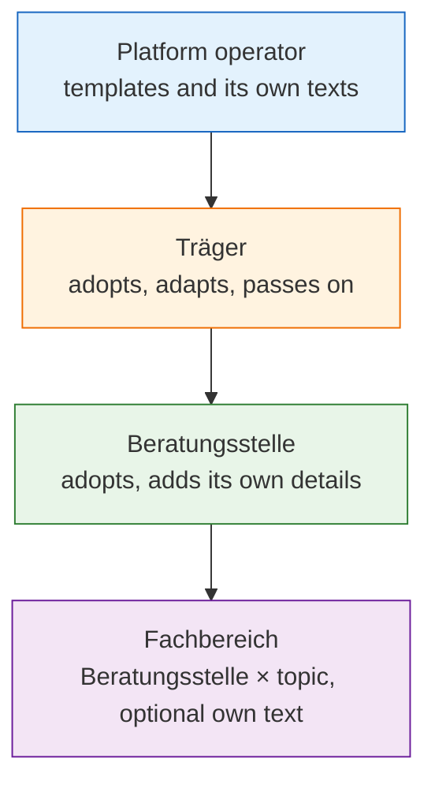

Every Beratungsstelle needs an imprint, a privacy policy and a consent sentence, and every Träger
has to conclude the contract documents with the platform operator. Without help, each of them
writes and maintains these texts on its own. ORISO turns this into a chain: the platform provides
templates, the Träger adopts and adapts them, and the Beratungsstelle adopts them in turn — in the
simplest case it only enters the name of its data protection officer.

This page describes **what** the feature does. It is written for Träger administrators, heads of
Beratungsstellen and data protection officers.

## 4.10.1 What you can do with it

- **Start from a template.** Adopt imprint, privacy policy and consent text from the level above
  instead of writing them from scratch.
- **Compare before you adopt.** When the level above publishes a new template, you see it side by
  side with your own text and decide whether to take it over.
- **Know which text was in force when.** Every published wording is kept as a version, with the
  date and the person who published it.
- **Translate before publishing.** A text can be machine-translated into the app's languages before
  it goes live.
- **Forward the contract documents.** Whoever sets up the Träger is rarely the person allowed to
  sign. The contract documents can be forwarded by e-mail or link to that person, and the
  administration shows whether the e-mail went out and whether the documents are signed.

## 4.10.2 Four levels, resolved from the bottom up

A client always sees the text of the lowest level that has one: the Fachbereich's text if it
exists, otherwise the Beratungsstelle's, otherwise the Träger's, otherwise the platform's. A Träger
text **replaces** the platform text; texts are never stacked on top of one another.

A template carries no legal force of its own. Changing a template never changes the text that
applies to anyone until the receiving level publishes its own new version.

## 4.10.3 The consent sentence belongs to the privacy policy

The sentence a client agrees to is part of the privacy policy, not a separate document. Changing
the sentence means publishing a new version of the policy, so "which consent belonged to which
policy" always has one answer. A consent sentence cannot be published unless it contains the
placeholder for the links to the legal texts, so the links can never go missing.

A client agrees twice at most: once to the platform's (or Träger's) text when entering, and once to
the Beratungsstelle's text in the conversation before the first message. ORISO stores only which
version a conversation is cleared for — no log of who agreed when.

## 4.10.4 Contract documents

The contract between the platform operator and a Träger consists of the contract documents: the
agreement itself with its annexes on data processing, technical and organisational measures,
subprocessors and the service description.

| Step | What happens |
|---|---|
| Publish | the platform operator publishes a version and, for a new version, sets a deadline for signing |
| Sign or forward | a Träger administrator signs, or forwards a single-use link to the authorised signer |
| Track | the administration shows: not signed · forwarded and waiting · signed · an older version signed |
| Confirm | after signing, a confirmation goes out by e-mail |
| New version | each new version is signed again; until the deadline the Träger works as normal |

<Note>
If the deadline passes without a signature, only **new** counselling is stopped. Running
conversations, logins of existing clients and access to existing histories are never interrupted.
Data protection enforcement must not endanger the people it exists to protect.
</Note>

## 4.10.5 Who does what

| Role | Can do |
|---|---|
| **Platform operator** | maintains templates and the platform's own texts; publishes contract document versions and deadlines |
| **Träger administrator** | adopts or adapts templates; passes them on to its Beratungsstellen; signs or forwards the contract documents |
| **Authorised signer** | opens the forwarded link and signs, without needing an ORISO account |
| **Head of Beratungsstelle** | adopts the Träger's texts, enters local details, publishes texts per Fachbereich |
| **Client** | reads the texts that apply and agrees before the conversation starts |

## 4.10.6 State of development

| Part | State |
|---|---|
| Text fields for imprint, privacy policy and terms per Träger | existed before ORISO |
| Contract documents workflow (sign, status) | commissioned with CAR-13 and built |
| Forwarding to the signer, re-confirmation of new versions, signing deadline | built |
| Templates passed from platform to Träger to Beratungsstelle, comparison, versions | built |
| Consent pointer per conversation (which version a conversation is cleared for) | built |
| Notice inside the chat when a Beratungsstelle publishes a new version; yes/no re-consent for substantial changes | decided ([ADR-022](/oriso-platform/decisions/ADR-022-consent-gates-and-re-consent-in-counselling-sessions), decisions 4 and 5), not yet found in the code |

## 4.10.7 Related

- [Legal-text hierarchy, versions and consent text (ADR-021)](/oriso-platform/decisions/ADR-021-legal-text-hierarchy-versioning-and-consent-text)
- [Consent gates and re-consent (ADR-022)](/oriso-platform/decisions/ADR-022-consent-gates-and-re-consent-in-counselling-sessions)
- [Platform Services Agreement and Träger governance (ADR-023)](/oriso-platform/decisions/ADR-023-platform-services-agreement-and-traeger-governance)
- [Fachbereich with imprint and privacy policy (ADR-003)](/oriso-platform/decisions/ADR-003-department-as-unique-agency-topic-with-imprint-dpp)
- [Shared legal texts, topic before consent (ADR-014)](/oriso-platform/decisions/ADR-014-shared-legal-text-objects-multi-topic-agencies-topic-before-consent)
- [Invitations and onboarding](/product/features/invitations-onboarding) — the Träger wizard includes the contract documents.
- Storybook, administration: [Contract documents](https://dev.oriso.org/storybook-admin/?path=/story/organisms-legal-dataprocessingagreementcontainer--platform-admin) ·
  [Forward to signer](https://dev.oriso.org/storybook-admin/?path=/story/organisms-dpaforwarddialog--default) ·
  [Received template (Träger)](https://dev.oriso.org/storybook-admin/?path=/story/organisms-legal-legaltext-received-template-tr%C3%A4ger--traeger-with-new-template) ·
  [Versions and consent](https://dev.oriso.org/storybook-admin/?path=/story/organisms-legal-departmentdataprotectioncard-versions-consent--with-version-history)
- Storybook, counselling app: [Consent before the first message](https://dev.oriso.org/storybook-frontend/?path=/docs/components-dialog-anonymousconsentgate--docs) ·
  [Signing page](https://dev.oriso.org/storybook-frontend/?path=/docs/pages-dpasign--docs)
