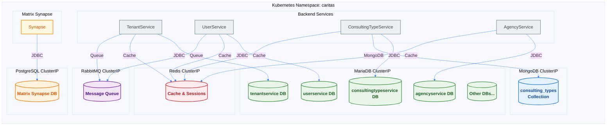

## Überblick über die Datenarchitektur

Die ORISO-Plattform verwendet mehrere Datenspeicher. Das Helm-Chart erstellt leere MariaDB-Datenbanken und Berechtigungen, und die zuständigen Dienste pflegen ihre eigenen Migrationen.



## Datenbanktypen

### MariaDB (primäre Datenbank)
- **Zweck:** Zentrale relationale Datenbank für Backend-Dienste
- **Gesamtzahl der Datenbanken:** 7
- **Dienstname:** `oriso-platform-mariadb.caritas.svc.cluster.local:3306`
- **Verbindungstyp:** ClusterIP (nur intern)
- **Datenbanken:**
  1. `tenantservice` – Mandantenverwaltung
  2. `userservice` – Benutzerverwaltung
  3. `consultingtypeservice` – Beratungsarten
  4. `agencyservice` – Beratungsstellenverwaltung
  5. Weitere Dienstdatenbanken nach Bedarf

### MongoDB
- **Zweck:** NoSQL-Speicher für Beratungsarten
- **Datenbank:** `consulting_types`
- **Dienstname:** `oriso-platform-mongodb.caritas.svc.cluster.local:27017`
- **Verbindungstyp:** ClusterIP (nur intern)
- **Verwendet von:** ConsultingTypeService

### PostgreSQL
- **Zweck:** Ausschließlich Datenbank für Matrix Synapse
- **Datenbank:** `synapse`
- **Dienstname:** `oriso-platform-postgresql.caritas.svc.cluster.local:5432`
- **Verbindungstyp:** ClusterIP (nur intern)
- **Verwendet von:** Matrix Synapse (nicht von Backend-Diensten)

### Redis
- **Zweck:** Caching und Sitzungsspeicherung
- **Dienstname:** `oriso-platform-redis.caritas.svc.cluster.local:6379`
- **Verbindungstyp:** ClusterIP (nur intern)
- **Funktionen:**
  - Sitzungsspeicherung
  - Cache für häufig abgerufene Daten
  - Begrenzung der Anfragerate
  - Temporäre Datenspeicherung

### RabbitMQ
- **Zweck:** Nachrichtenwarteschlange für asynchrone Verarbeitung
- **Dienstname:** `oriso-platform-rabbitmq.caritas.svc.cluster.local:5672`
- **Verwaltungsoberfläche:** Port 15672 (ClusterIP)
- **Verbindungstyp:** ClusterIP (nur intern)
- **Funktionen:**
  - Asynchrone Aufgabenverarbeitung
  - Veröffentlichung von Ereignissen
  - Arbeitswarteschlangen

## Schemaverwaltung und Datenbankeinrichtung

- **Leere Datenbank:** Legen Sie Datenbanken und Berechtigungen mit dem aktuellen Helm-Chart an und wenden Sie anschließend die Service-Migrationen an.
- **Vorhandene Datenbank:** Prüfen Sie den Migrationsstand und die Liquibase-Konfiguration des zuständigen Dienstes.
- **Wiederherstellung:** Wählen Sie eine zur Zielversion passende Sicherung und prüfen Sie das Ergebnis in einer isolierten Umgebung.

Die Anleitung verlinkt die Helm-Initialisierung, Service-Changelogs und Prüfpfade. Die SQL-Schemadateien im Chart dienen als Referenz. [Datenbanken einrichten](/oriso-platform/setup-databases)

## Verbindungszeichenfolgen

### MariaDB-Verbindung
```properties
# application.properties
spring.datasource.url=jdbc:mariadb://oriso-platform-mariadb.caritas.svc.cluster.local:3306/userservice
spring.datasource.username=${MYSQL_USER}
spring.datasource.password=${MYSQL_PASSWORD}
```

### MongoDB-Verbindung
```properties
spring.data.mongodb.uri=mongodb://oriso-platform-mongodb.caritas.svc.cluster.local:27017/consulting_types
```

### Redis-Verbindung
```properties
spring.redis.host=oriso-platform-redis.caritas.svc.cluster.local
spring.redis.port=6379
spring.redis.password=${REDIS_PASSWORD}
```

### RabbitMQ-Verbindung
```properties
spring.rabbitmq.host=oriso-platform-rabbitmq.caritas.svc.cluster.local
spring.rabbitmq.port=5672
spring.rabbitmq.username=${RABBITMQ_USER}
spring.rabbitmq.password=${RABBITMQ_PASSWORD}
```

## Sicherung und Wiederherstellung

Die Sicherungsanleitung verweist auf die gepflegten Runbooks. Prüfen Sie dort die für Ihre Umgebung konfigurierten Sicherungen sowie Aufbewahrung und Wiederherstellung. [Sicherungen konfigurieren](/oriso-platform/backup-configuration)

## Datenpersistenz

### Persistente Volumes
Alle Datenbanken verwenden Kubernetes PersistentVolumeClaims (PVCs):
- **MariaDB:** `mariadb-data` (20Gi)
- **MongoDB:** `mongodb-data` (10Gi)
- **PostgreSQL:** `matrix-postgres-data` (10Gi)
- **Redis:** `redis-data` (5Gi)
- **RabbitMQ:** `rabbitmq-data` (5Gi)

### Aufbewahrung der Volumes

Die Aufbewahrung hängt vom Chart und von der konfigurierten StorageClass ab. Prüfen Sie die Regeln für Volumes und Sicherungen vor einem Upgrade oder einer Deinstallation. [Kubernetes-Deployment](/docs/platform/kubernetes-deployment) · [Sicherungen konfigurieren](/oriso-platform/backup-configuration)

## Sicherheit

### Ausschließlich interner Zugriff
Alle Datenbanken sind ClusterIP-Dienste (nicht extern erreichbar):
- Kein direkter externer Zugriff
- Nur innerhalb des Kubernetes-Clusters erreichbar
- Dienste verbinden sich über Kubernetes-DNS.

### Verwaltung von Zugangsdaten
Alle Datenbankzugangsdaten werden in Kubernetes Secrets gespeichert:
```bash
# MariaDB secrets
kubectl get secret mariadb-secrets -n caritas

# Redis secrets
kubectl get secret redis-secret -n caritas

# RabbitMQ secrets
kubectl get secret rabbitmq-secrets -n caritas
```

## Überwachung

### Datenbank-Zustandsprüfungen
Dienste stellen den Datenbankzustand über Actuator bereit:
```bash
curl http://oriso-platform-userservice.caritas.svc.cluster.local:8082/actuator/health
```

**Antwort:**
```json
{
  "status": "UP",
  "components": {
    "db": {
      "status": "UP",
      "details": {
        "database": "MariaDB",
        "validationQuery": "isValid()"
      }
    }
  }
}
```

## Fehlerbehebung

### Probleme mit Datenbankverbindungen
```bash
# Test MariaDB connection
kubectl exec -n caritas deployment/oriso-platform-userservice -- \
  mysql -h oriso-platform-mariadb.caritas.svc.cluster.local -u user -p

# Check database pod
kubectl get pods -n caritas | grep mariadb

# Check database logs
kubectl logs -n caritas deployment/oriso-platform-mariadb
```

### Schemaprobleme
```bash
# Verify schema exists
kubectl exec -n caritas deployment/oriso-platform-mariadb -- \
  mysql -u root -p -e "SHOW DATABASES;"

# Check table structure
kubectl exec -n caritas deployment/oriso-platform-mariadb -- \
  mysql -u root -p userservice -e "SHOW TABLES;"
```

### Probleme bei Sicherung und Wiederherstellung

Prüfen Sie das Sicherungsartefakt und führen Sie die Wiederherstellung zuerst in einer isolierten Umgebung nach dem Runbook für den jeweiligen Datenspeicher durch. [Sicherungen konfigurieren](/oriso-platform/backup-configuration)
