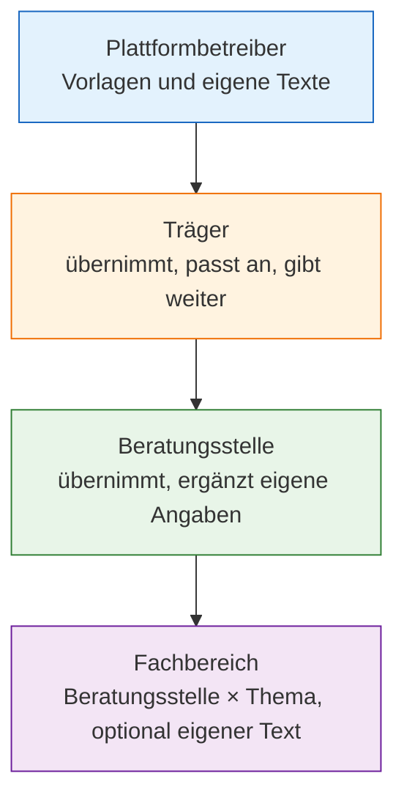

Jede Beratungsstelle braucht ein Impressum, eine Datenschutzerklärung und einen Einwilligungssatz,
und jeder Träger muss mit dem Plattformbetreiber die Vertragsunterlagen abschließen. Ohne Hilfe
schreibt und pflegt jede Stelle diese Texte allein. ORISO macht daraus eine Kette: Die Plattform
stellt Vorlagen bereit, der Träger übernimmt und passt sie an, die Beratungsstelle übernimmt sie
ihrerseits — im einfachsten Fall trägt sie nur noch den Namen ihrer Datenschutzbeauftragten ein.

Diese Seite beschreibt, **was** die Funktion tut. Sie richtet sich an Verwaltende von Trägern,
Leitungen von Beratungsstellen und Datenschutzbeauftragte.

## 4.10.1 Das kann ich damit machen

- **Mit einer Vorlage beginnen.** Impressum, Datenschutzerklärung und Einwilligungssatz von der
  Ebene darüber übernehmen, statt sie neu zu schreiben.
- **Vergleichen, bevor ich übernehme.** Veröffentlicht die Ebene darüber eine neue Vorlage, sehe ich
  sie neben meinem eigenen Text und entscheide, ob ich sie übernehme.
- **Wissen, welcher Text wann galt.** Jede veröffentlichte Fassung bleibt als Version erhalten, mit
  Datum und der Person, die sie veröffentlicht hat.
- **Vor dem Veröffentlichen übersetzen.** Ein Text lässt sich maschinell in die Sprachen der App
  übersetzen, bevor er online geht.
- **Die Vertragsunterlagen weiterleiten.** Wer den Träger einrichtet, darf selten selbst
  unterschreiben. Die Vertragsunterlagen lassen sich per E-Mail oder Link an die
  zeichnungsberechtigte Person weiterleiten; die Verwaltung zeigt, ob die E-Mail versendet wurde und
  ob unterschrieben ist.

## 4.10.2 Vier Ebenen, von unten nach oben aufgelöst

Ratsuchende sehen immer den Text der untersten Ebene, die einen hat: den des Fachbereichs, falls es
ihn gibt, sonst den der Beratungsstelle, sonst den des Trägers, sonst den der Plattform. Ein
Träger-Text **ersetzt** den Plattform-Text; Texte werden nie übereinandergestapelt.

Eine Vorlage hat selbst keine rechtliche Wirkung. Eine geänderte Vorlage ändert den geltenden Text
für niemanden, bis die empfangende Ebene eine eigene neue Version veröffentlicht.

## 4.10.3 Der Einwilligungssatz gehört zur Datenschutzerklärung

Der Satz, dem Ratsuchende zustimmen, ist Teil der Datenschutzerklärung, kein eigenes Dokument. Wer den
Satz ändert, veröffentlicht eine neue Version der Erklärung; so hat die Frage „welche Einwilligung
gehörte zu welcher Erklärung“ immer genau eine Antwort. Ein Einwilligungssatz lässt sich nur
veröffentlichen, wenn er den Platzhalter für die Links zu den Rechtstexten enthält — die Links
können also nie fehlen.

Ratsuchende stimmen höchstens zweimal zu: beim Eintreten dem Text der Plattform (oder des Trägers)
und im Gespräch vor der ersten Nachricht dem Text der Beratungsstelle. ORISO speichert nur, für
welche Version ein Gespräch freigegeben ist — kein Protokoll, wer wann zugestimmt hat.

## 4.10.4 Vertragsunterlagen

Der Vertrag zwischen Plattformbetreiber und Träger besteht aus den Vertragsunterlagen: dem
Plattformvertrag selbst mit seinen Anlagen zur Auftragsverarbeitung, zu den technischen und
organisatorischen Maßnahmen, zu den Unterauftragsverarbeitern und zur Leistungsbeschreibung.

| Schritt | Was passiert |
|---|---|
| Veröffentlichen | der Plattformbetreiber veröffentlicht eine Fassung und setzt für eine neue Fassung eine Frist zur Unterschrift |
| Unterschreiben oder weiterleiten | eine Verwaltende des Trägers unterschreibt oder leitet einen Einmal-Link an die zeichnungsberechtigte Person weiter |
| Stand verfolgen | die Verwaltung zeigt: nicht unterschrieben · weitergeleitet und wartend · unterschrieben · ältere Fassung unterschrieben |
| Bestätigung | nach der Unterschrift geht eine Bestätigung per E-Mail hinaus |
| Neue Fassung | jede neue Fassung wird erneut unterschrieben; bis zur Frist arbeitet der Träger normal weiter |

<Note>
Läuft die Frist ohne Unterschrift ab, werden nur **neue** Beratungen gesperrt. Laufende Gespräche,
Anmeldungen bestehender Ratsuchender und der Zugang zu bisherigen Verläufen werden nie unterbrochen.
Durchsetzung des Datenschutzes darf die Menschen nicht gefährden, die er schützen soll.
</Note>

## 4.10.5 Wer was tut

| Rolle | Kann |
|---|---|
| **Plattformbetreiber** | pflegt Vorlagen und die eigenen Texte der Plattform; veröffentlicht Fassungen der Vertragsunterlagen und Fristen |
| **Verwaltende des Trägers** | übernehmen oder passen Vorlagen an; geben sie an ihre Beratungsstellen weiter; unterschreiben die Vertragsunterlagen oder leiten sie weiter |
| **Zeichnungsberechtigte Person** | öffnet den weitergeleiteten Link und unterschreibt, ohne ein ORISO-Konto zu brauchen |
| **Leitung der Beratungsstelle** | übernimmt die Texte des Trägers, ergänzt örtliche Angaben, veröffentlicht Texte je Fachbereich |
| **Ratsuchende** | lesen die geltenden Texte und stimmen vor Beginn des Gesprächs zu |

## 4.10.6 Stand der Entwicklung

| Teil | Stand |
|---|---|
| Textfelder für Impressum, Datenschutz und Nutzungsbedingungen je Träger | gab es schon vor ORISO |
| Ablauf der Vertragsunterlagen (unterschreiben, Stand) | mit CAR-13 beauftragt und gebaut |
| Weiterleitung an die zeichnungsberechtigte Person, erneute Bestätigung neuer Fassungen, Frist zur Unterschrift | gebaut |
| Vorlagen von der Plattform über den Träger an die Beratungsstelle, Vergleich, Versionen | gebaut |
| Freigabe je Gespräch (für welche Version ein Gespräch freigegeben ist) | gebaut |
| Hinweis im Chat, wenn eine Beratungsstelle eine neue Version veröffentlicht; Ja/Nein-Zustimmung bei wesentlichen Änderungen | entschieden ([ADR-022](/oriso-platform/decisions/ADR-022-consent-gates-and-re-consent-in-counselling-sessions), Entscheidungen 4 und 5), im Code noch nicht gefunden |

## 4.10.7 Verwandte Seiten

- [Rechtstexte: Hierarchie, Versionen, Einwilligungstext (ADR-021)](/oriso-platform/decisions/ADR-021-legal-text-hierarchy-versioning-and-consent-text)
- [Einwilligung und erneute Einwilligung im Gespräch (ADR-022)](/oriso-platform/decisions/ADR-022-consent-gates-and-re-consent-in-counselling-sessions)
- [Plattformvertrag und Steuerung durch Träger (ADR-023)](/oriso-platform/decisions/ADR-023-platform-services-agreement-and-traeger-governance)
- [Fachbereich mit Impressum und Datenschutz (ADR-003)](/oriso-platform/decisions/ADR-003-department-as-unique-agency-topic-with-imprint-dpp)
- [Gemeinsame Rechtstexte, Thema vor Einwilligung (ADR-014)](/oriso-platform/decisions/ADR-014-shared-legal-text-objects-multi-topic-agencies-topic-before-consent)
- [Einladungen und Einrichtung](/product/features/invitations-onboarding) — der Träger-Assistent enthält die Vertragsunterlagen.
- Storybook Verwaltung: [Vertragsunterlagen](https://dev.oriso.org/storybook-admin/?path=/story/organisms-legal-dataprocessingagreementcontainer--platform-admin) ·
  [Weiterleiten](https://dev.oriso.org/storybook-admin/?path=/story/organisms-dpaforwarddialog--default) ·
  [Empfangene Vorlage (Träger)](https://dev.oriso.org/storybook-admin/?path=/story/organisms-legal-legaltext-received-template-tr%C3%A4ger--traeger-with-new-template) ·
  [Versionen und Einwilligung](https://dev.oriso.org/storybook-admin/?path=/story/organisms-legal-departmentdataprotectioncard-versions-consent--with-version-history)
- Storybook Beratungs-App: [Einwilligung vor der ersten Nachricht](https://dev.oriso.org/storybook-frontend/?path=/docs/components-dialog-anonymousconsentgate--docs) ·
  [Seite zum Unterschreiben](https://dev.oriso.org/storybook-frontend/?path=/docs/pages-dpasign--docs)
